# Mobile UI prototype

This draft begins Mesh Client's iOS and Android work with a responsive UI shell and screenshot scenes for phones, tablets, and foldables. It retains the existing branding and focuses design review on Bluetooth radio connection, protocol switching, and messaging. The first goal is to settle layout, navigation, copy, and accessibility before implementing mobile transports.

Reviewer controls, shell navigation, and the protocol switcher can change the displayed mock view. Each protocol has its own sample radio, conversation, current scene, and locally editable draft. Switching protocols restores that protocol's scene and draft within the current browser session. Connection, pairing, reconnect, and disconnect controls only navigate between static scenes. The send and retry-message controls are disabled visual placeholders. There is no real or simulated connection workflow, message queue, or message delivery. The prototype does not access hardware, invoke Electron IPC, show OS prompts, or open OS settings. Sample radio and message statuses are design fixtures, and native packets are never sent.

## Run and build

Run these commands from the repository root after the normal [development setup](../development-environment.md):

```sh
pnpm exec vite --config vite.mobile-prototype.config.mjs
```

Open <http://127.0.0.1:5175/>. The entry is `src/renderer/mobile/index.html`; the mobile Vite root is `src/renderer/mobile`.

The display review presets can also be selected with `?display=phone`, `?display=tablet`, or `?display=foldable`. For example, <http://127.0.0.1:5175/?display=tablet&scene=chat&protocol=meshcore> opens the tablet chat scene with MeshCore sample content.

Build a standalone browser preview:

```sh
pnpm exec vite build --config vite.mobile-prototype.config.mjs
pnpm exec vite preview --config vite.mobile-prototype.config.mjs
```

The build output is `dist/mobile-prototype`. Use the URL printed by the preview command. This is a browser design artifact, not an installable iOS or Android app.

## Design direction

The [UI style guide](../style-guide.md) and Mesh Client's existing components remain the sources for the design. The prototype uses ink surfaces, bundled IBM Plex Sans and Mono, existing radius and elevation tokens, and emerald, cyan, and yellow protocol identities. It reuses `chat/ConversationLayout` for the conversation panes and the shared `ProtocolSwitcher` for protocol selection. Primary actions use the accent with dark text; connection status uses a semantic status color accompanied by text or an icon.

The revised shell follows the client's compact visual hierarchy: a 52-pixel section header, a bottom status bar, bounded conversation panels, compact conversation rows, and restrained pane titles. The list includes a disabled search field to show its placement. Messages use 14-pixel body text at the default scale, compact sender and timestamp lines, sender initials in the gutter, and incoming/outgoing bubble tokens. The composer uses the client's field treatment and Send icon. The phone bottom navigation highlights the active icon with a pill rather than filling the whole navigation cell.

At narrow widths, the shell gives each task a single pane and puts the main action within comfortable reach. Interactive targets are at least 48 CSS pixels in each dimension. Text uses rem sizes and supports 200% enlargement. At narrow widths with enlarged text, navigation reflows into two rows and radio metadata stays in the main text column. Safe-area padding protects content from screen cutouts and the home gesture area. Reduced motion removes decorative movement.

Navigation keeps the familiar Chat, Network, Map, Incident, and More destinations. It appears at the bottom in the narrow layout and in a left rail when the shell has enough room. Chat shows conversation and message layouts. More opens a launcher in a native HTML `<dialog>`; Connection and Chat select their mock views, while the remaining panels are disabled and labelled as future scope. The wide rail pins Incident and App below its scrolling primary navigation. App remains a disabled placeholder; Device opens the connection scenes. These controls do not imply that mobile network management, maps, incident operations, or settings are implemented.

Platform, display, and scene controls sit outside the app shell. Selecting iOS or Android changes the review context and permission explanation. Selecting a scene previews a static state. These controls are for reviewers and do not belong in the eventual mobile app. The prototype disclosure also stays outside the shell so implementation notes do not compete with the chat. The protocol chooser and launcher use browser `<dialog>` elements; they are not native Bluetooth or OS permission dialogs.

## Adaptive layout

The available shell width determines the layout. A 48em fit threshold enables the wide layout, about 768 CSS pixels at default text size. At that text size, the wide shell uses the client's 72-pixel navigation rail, a 288-pixel conversation list, and a flexible chat pane inside the shared `ConversationLayout`. With insufficient room, only the conversation list or the selected chat is shown. At 200% text, the fit threshold grows with the text size and collapses the split when both panes would be too cramped.

Wide layouts put the shared vertical protocol segments directly on the rail. A radio-details trigger beside them opens a compact chooser popover with full-name segments and sample radio rows. Compact layouts open the same chooser from the header as a bottom sheet. Both use the client's shared horizontal protocol segments inside the chooser, with sample link and unread information in the rows below.

Phone, Tablet, and Foldable are generic review presets. The tablet shell has a maximum width of 1024 CSS pixels and the foldable shell a maximum width of 896 CSS pixels. The actual available window width still controls the split, so a narrow window can collapse either preset. These values are prototype layout choices, not hardware specifications. A hypothetical iPhone Duo is covered by the generic foldable design goal; this draft assumes no dimensions, hinge position, or released Apple foldable model.

Resizing between narrow and wide layouts keeps the current protocol, scene, and draft. The wide conversation-list scene shows the list beside a prompt to choose a conversation; selecting the sample conversation opens chat in the adjacent pane. The narrow layout opens it as a single view with a path back to the list. Drafts are held in component memory and are not durable storage across reloads.

The browser preview does not detect a real fold, hinge, or posture. Native Android layouts will need reported folding-feature bounds and separation or occlusion state before placing panes and controls around a hinge. Keyboard insets, short landscape windows, multiwindow resizing, and folded-to-unfolded continuity require native validation. CSS safe-area padding and browser width presets do not establish IME or hinge safety.

## Reviewer walkthrough

1. Open a chat scene and type a sample draft. Sending remains disabled.
2. On a phone, open the protocol chooser from the header and select another protocol. On a wide layout, use the rail's protocol segments directly or open the radio-details chooser. Review its sample radio and conversation, then enter a different draft.
3. Switch back and verify the earlier protocol's scene and draft are restored. Close the chooser and check focus returns to its trigger.
4. Select Tablet or Foldable in the display review control. Widen the window to review the conversation list beside chat, then narrow it to review the single-pane form.
5. Repeat with 200% text. Confirm the layout collapses when needed without losing the selected scene or local draft.
6. Use the scene selector to inspect connection and message failure designs. The scene changes do not connect a radio or transmit a message.
7. Open More on a phone or App on a wide layout. Select Connection or Chat to preview that destination, and confirm the remaining launcher entries are visibly disabled. Close the launcher and check focus returns to its trigger.

## Screenshot scenes

| Scene             | Design question                                                                                                |
| ----------------- | -------------------------------------------------------------------------------------------------------------- |
| Radio start       | Is the first connection action obvious, and does the preparation text explain what the user needs?             |
| Nearby radios     | Can the user distinguish radios by name, protocol, and secondary information without relying on color?         |
| Permission        | Does the explanation connect Bluetooth access to finding and connecting a radio?                               |
| Permission denied | Are the limitation and proposed recovery instruction clear?                                                    |
| Connecting        | Is progress readable, with a visible proposed cancellation action?                                             |
| Connected         | Are the named radio and link state apparent, with a clear path to chat?                                        |
| Connection failed | Is failure distinguishable from progress, with understandable proposed retry and choose-another-radio actions? |
| Conversations     | Is it easy to find a channel or conversation on a phone?                                                       |
| Chat              | Are sender, time, message text, and composer arranged for readable mobile messaging?                           |
| Send failed       | Is the failed-message treatment explicit, with understandable proposed retry action?                           |

Screenshots document the visual states. They do not demonstrate a transition between those states, permission approval, a successful radio handshake, or delivery of a message. Future-scope and prototype labels must remain visible so a scene cannot be mistaken for working mobile functionality.

Permission denial and Bluetooth off should remain distinct in the eventual workflow. Radio connection, pairing, reading radio settings, and peer reachability also need distinct states. The ready scene must not imply that a connected radio guarantees a reachable recipient.

The [existing BLE contracts](ble-serial.md#lora-ble-reconnect-parity-meshtastic--meshcore) require deliberate disconnect to remain disconnected. Preserve that contract when behavior is implemented. The current static disconnect control does not exercise it.

## Captured screens

The phone screenshots show the shell at normal text size. The iOS phone review context is 390 pixels wide, and the Android phone context is 412 pixels wide. Additional captures show the compact protocol chooser, More launcher, and generic wide layouts. Wide captures include the full viewport so a top-layer popover cannot be cropped by the app container. These are browser captures; they do not show native OS chrome, permission dialogs, a real hinge, or a physical device.

| iOS                                                                                      | Android                                                                                  |
| ---------------------------------------------------------------------------------------- | ---------------------------------------------------------------------------------------- |
| 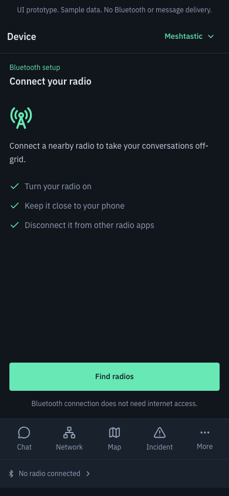             | 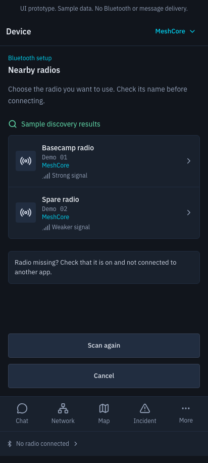       |
| 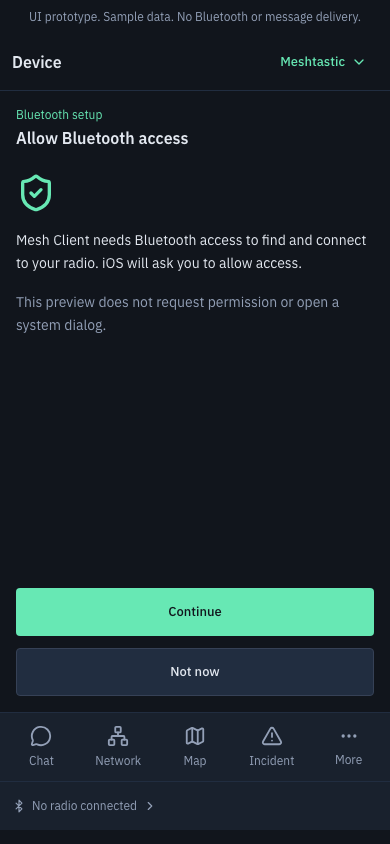 | 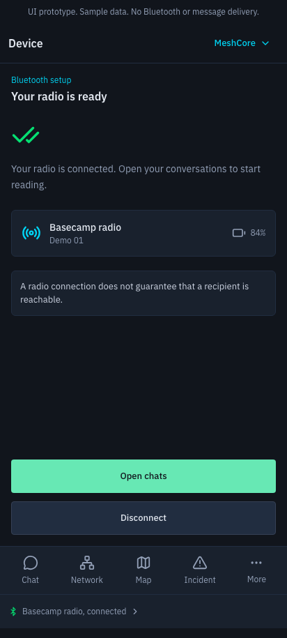        |
| 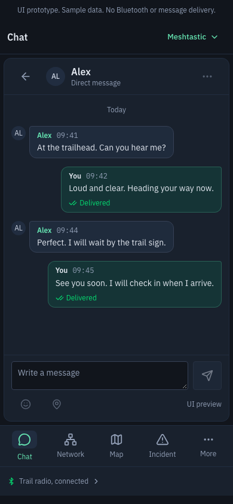                    | 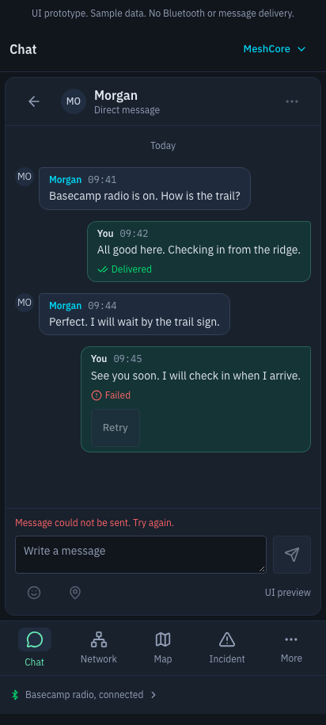 |

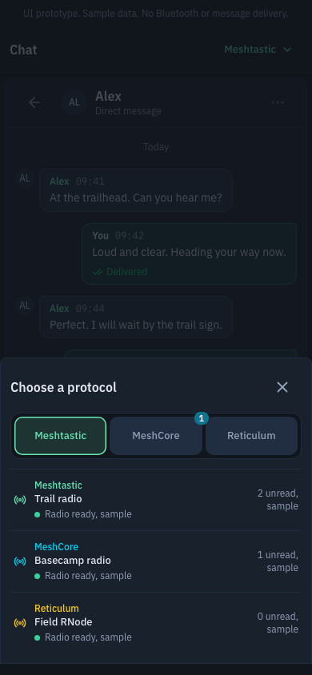

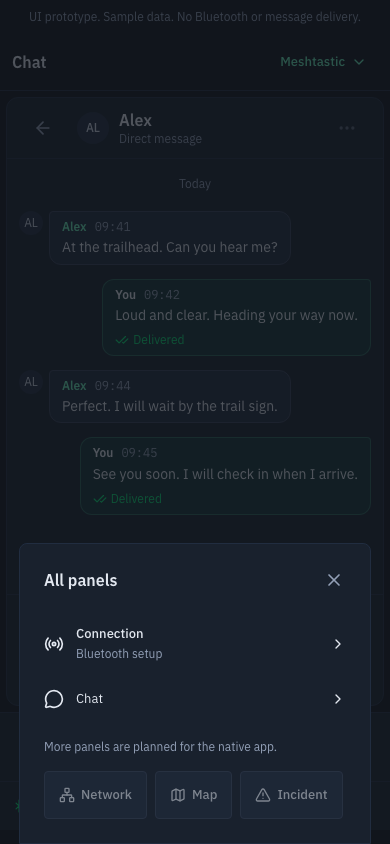

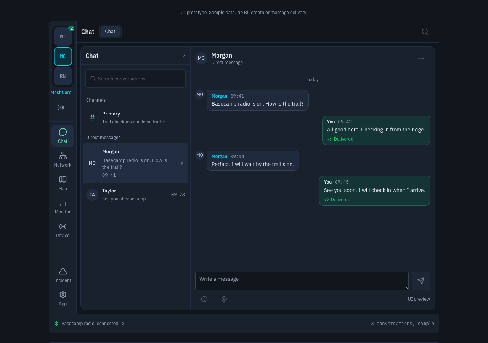

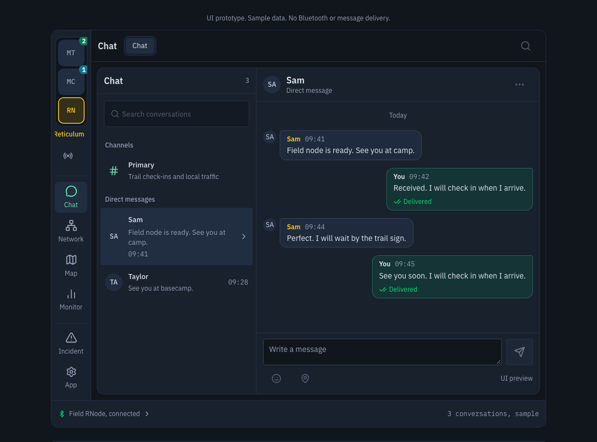

The chooser uses a bottom sheet on compact layouts and a compact popover beside the rail's radio-details trigger on wide layouts. Folding or resizing while it is open updates the presentation and preserves focus. Wide protocol selection is also available directly from the rail without opening the chooser.

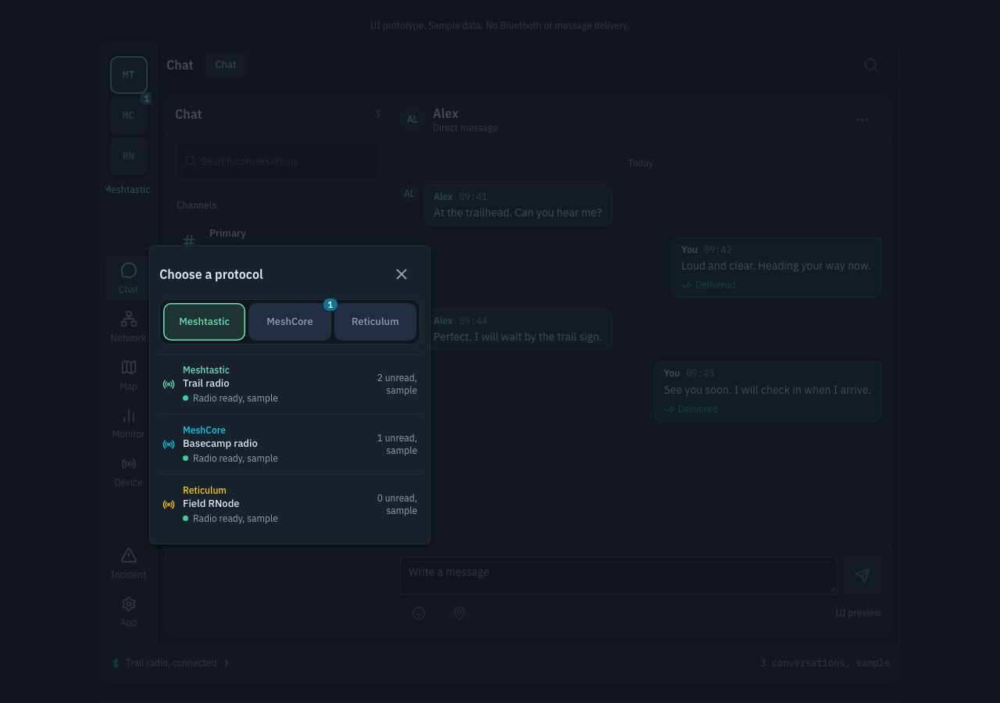

## Platform requirements for later implementation

These requirements inform the scenes and future architecture. They are not implemented native capabilities in this draft.

| Area                 | iOS                                                                                                                                                       | Android                                                                                                                                                                                            |
| -------------------- | --------------------------------------------------------------------------------------------------------------------------------------------------------- | -------------------------------------------------------------------------------------------------------------------------------------------------------------------------------------------------- |
| Bluetooth permission | Use Core Bluetooth authorization and a meaningful `NSBluetoothAlwaysUsageDescription`. Distinguish authorization denied or restricted from adapter state. | Android 12 and later require runtime scan/connect permissions for the relevant operations, presented as Nearby devices access. Earlier supported Android versions need a separate permission plan. |
| Pairing              | Leave system pairing to the native Bluetooth boundary; do not carry over the desktop Windows PIN workflow as an iOS form.                                 | Integrate the native pairing flow when the selected radio requires it and preserve cancel and failure outcomes.                                                                                    |
| Navigation           | Preserve familiar back and modal dismissal behavior.                                                                                                      | Support system back and predictive back. A cancelled back gesture must not commit navigation or radio changes.                                                                                     |
| Insets and text      | Respect safe areas and support Dynamic Type or an equivalent scaling path.                                                                                | Respect system bars, display cutouts, gesture insets, and system text scaling.                                                                                                                     |
| Adaptive layout      | Collapse split navigation when available space is limited, preserving the selected conversation and draft.                                                | Adapt to the current app window and reported fold features, with pane placement clear of separating or occluding hinges.                                                                           |

Request permission when the user chooses the feature that needs it and allow a declined request to return to a usable interface. Do not repeatedly prompt after denial or treat permission approval as a successful radio connection. Returning from real settings must recheck authorization and adapter state.

For Android, `neverForLocation` is a promise about the use of Bluetooth scan results and can filter some BLE beacons. Select it only after verifying the intended radio discovery behavior and location requirements. Map or phone-location features require their own permission decisions; Bluetooth access is not a blanket location grant.

The desktop app currently connects Meshtastic and MeshCore through the Rust sidecar's GATT transport and Electron IPC. That implementation is evidence about protocol and connection contracts, not a mobile runtime. Mobile BLE ownership, supported protocols and radios, foreground/background behavior, reconnect budgets, and framework choice need a separate architecture decision and physical-device validation.

## Visual review checklist

The revised shell passed 1,320 layout combinations across both platform contexts, all three protocols, ten scenes, Phone/Tablet/Foldable presets, widths from 320 to 1366 CSS pixels, and 100%/200% text. Checked visible shell targets were at least 48 by 48 CSS pixels, with no horizontal page overflow or browser page errors. All 180 scene axe runs and two modal axe runs passed, for 182 browser accessibility checks. The protocol chooser and launcher were also checked for focus handling and dismissal. Protocol switching and folded/unfolded resizing preserved separate local drafts.

The 55 focused component tests include real-theme axe coverage, protocol context isolation, adaptive semantics, and the More launcher. The full local gate passed with 15,635 tests passing and five skipped. The final popover-position regression also passed separately. Native-device checks remain separate.

- [x] Review every scene in the iOS and Android contexts across Phone, Tablet, and Foldable presets.
- [x] Verify reviewer controls and shell navigation show the intended mock views, with accessible names and a clear selected state.
- [x] Verify rail protocol selection, the compact and wide choosers, focus handling, per-protocol scene restoration, and local draft restoration.
- [x] Verify the More/App launcher, selectable Connection and Chat destinations, disabled future panels, and focus restoration.
- [x] Verify connection and messaging controls are recognizable visual placeholders and do not imply real or simulated transport behavior.
- [x] Confirm prototype, sample-data, and future-scope labels remain clear in the refreshed screenshots.
- [x] Review phone widths of 320, 390, and 430 CSS pixels plus wide and collapsed tablet/foldable windows at default and 200% text. No page-level horizontal overflow, clipped labels, overlapping targets, or hidden content.
- [x] Resize across the split threshold and verify the current protocol, scene, and draft remain intact.
- [x] Check every interactive target is at least 48 by 48 CSS pixels and adjacent actions are easy to distinguish.
- [ ] Check safe-area padding around the header and bottom navigation. Browser screenshots do not verify native system insets or gestures.
- [x] Check keyboard navigation, visible focus, accessible names, logical reading order, and selected navigation semantics.
- [x] Check status and failure text is understandable without color alone.
- [x] Check text and non-text contrast against the actual theme tokens; run axe with the repository's real-theme hydration helper for component coverage.
- [x] Check reduced-motion behavior and bundled assets in the updated built preview, including with external network requests blocked.
- [x] Build the standalone preview and run the focused component checks for the revised shell.
- [x] Complete the full repository gate required by `AGENTS.md` for the revised shell.

Native VoiceOver and TalkBack, permission and pairing prompts, hardware discovery, radio handshakes, real message delivery and acknowledgements, fold posture and hinge handling, IME behavior, background behavior, and platform packaging remain unverified by this browser UI shell.

## Research sources

Primary platform documentation was checked on October 13, 2026:

- [Apple accessibility guidance](https://developer.apple.com/design/human-interface-guidelines/accessibility): iOS defaults include 44-point controls and 17-point custom text, and guidance recommends supporting at least 200% text enlargement. The shared 48-pixel prototype target is a design choice; CSS pixels do not constitute native point or dp validation.
- [Apple safe-area layout guide](https://developer.apple.com/documentation/uikit/uiview/safearealayoutguide): content and controls must account for bars and other obscuring views.
- [Apple Bluetooth usage description](https://developer.apple.com/documentation/bundleresources/information-property-list/nsbluetoothalwaysusagedescription) and [Core Bluetooth authorization states](https://developer.apple.com/documentation/corebluetooth/cbmanagerauthorization): explain access and handle authorization states explicitly.
- [Android accessibility guidance](https://developer.android.com/guide/topics/ui/accessibility/apps): recommends targets of at least 48 by 48 dp, meaningful control descriptions, and sufficient contrast.
- [Android Bluetooth permissions](https://developer.android.com/develop/connectivity/bluetooth/bt-permissions): defines version-specific scan/connect permissions and the limitations of `neverForLocation`.
- [Android runtime permission workflow](https://developer.android.com/training/permissions/requesting): request access in context, permit cancellation, and handle denial gracefully.
- [Android system bars](https://developer.android.com/design/ui/mobile/guides/foundations/system-bars) and [predictive back design](https://developer.android.com/design/ui/mobile/guides/patterns/predictive-back): preserve system navigation and keep interactive content clear of gesture areas.
- [Apple adaptive layout guidance](https://developer.apple.com/design/human-interface-guidelines/layout) and [NavigationSplitView](https://developer.apple.com/documentation/swiftui/navigationsplitview): adapt to window and text-size changes, collapsing columns at narrow sizes.
- [Android window size classes](https://developer.android.com/develop/ui/compose/layouts/adaptive/use-window-size-classes) and [list-detail layouts](https://developer.android.com/develop/ui/compose/layouts/adaptive/list-detail): use current app-window space and show list and detail together when enough room is available. Native dp classes do not validate this prototype's CSS-pixel thresholds.
- [Android fold-aware layouts](https://developer.android.com/develop/ui/compose/layouts/adaptive/foldables/make-your-app-fold-aware): use folding-feature bounds, separation, and occlusion to place content around an actual fold or hinge.
- [Android inset handling](https://developer.android.com/develop/ui/compose/system/insets-ui): account for system bars and IME insets so keyboard changes do not hide interactive content.

## Decisions after design review

Agree on the first supported protocols and radios, minimum OS versions, behavior while the phone is locked or the app is backgrounded, and whether one or multiple radio links are needed. Then choose the native framework and transport boundary, implement connection and messaging workflows, plan persistence, and define a physical iOS/Android test matrix. Signing, store distribution, notifications, and the remaining product areas belong to that later scope.
